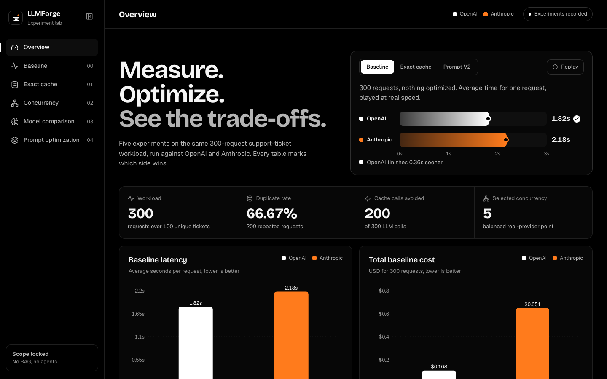
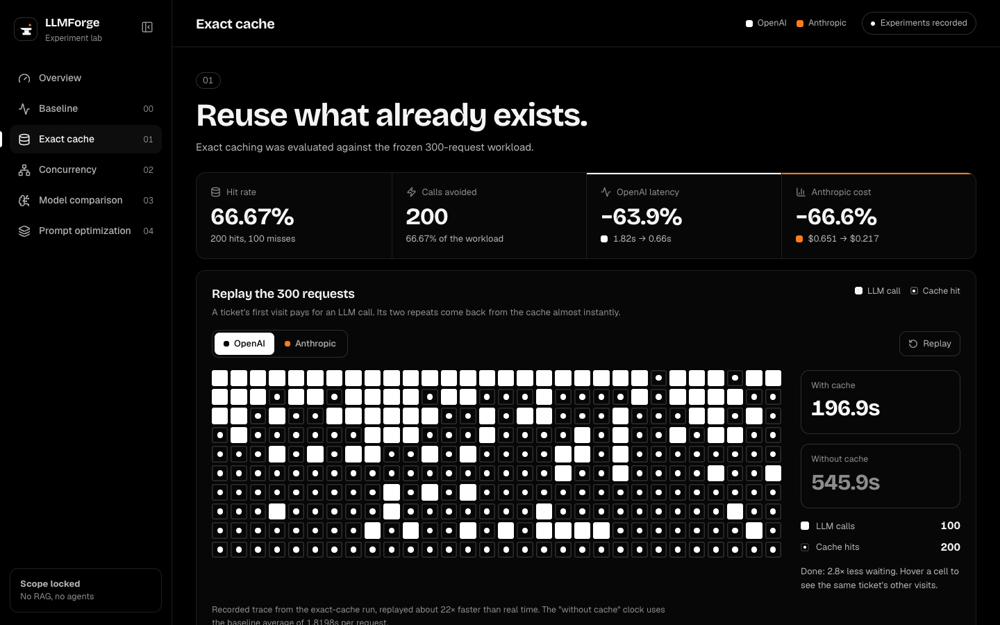
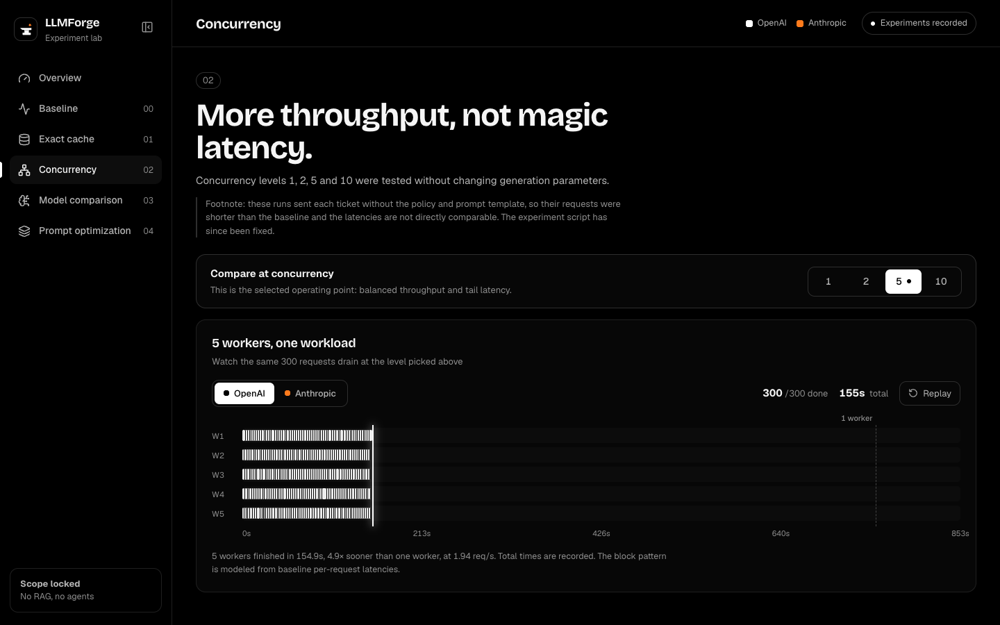
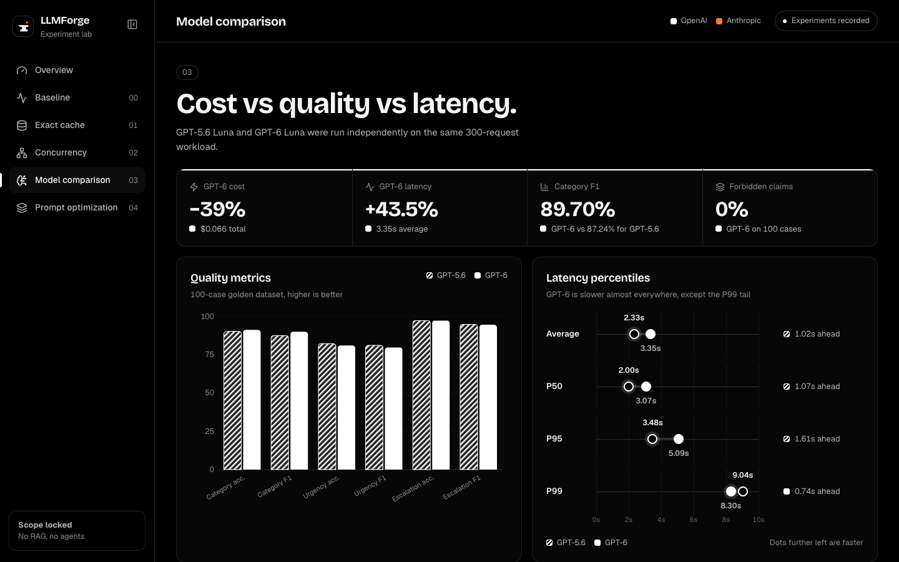
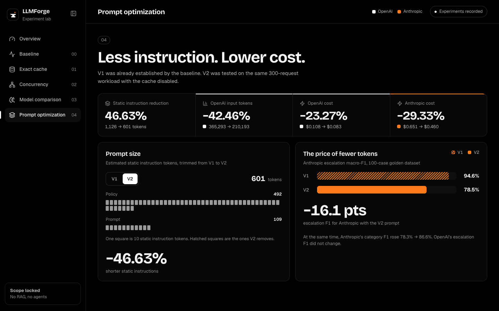
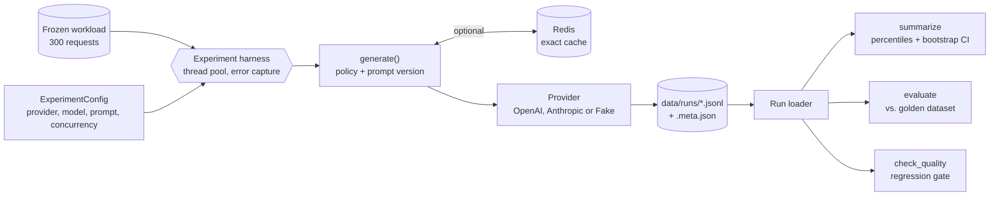

# LLMForge

**Measure first, then optimize.** LLMForge is a lab for testing the optimizations people apply to
production LLM apps (caching, concurrency, model choice, prompt compression). Each one runs on the
same frozen workload, and the result is judged by latency, cost and quality together, with a check
that the difference is bigger than run-to-run noise.

**Live dashboard:** [llmforge.netlify.app](https://llmforge.netlify.app)



---

## Why

Most optimization advice is a claim ("add a cache", "use a cheaper model", "shorten the prompt")
with no measurement of what it costs. LLMForge tests each one the same way:

1. **Baseline:** run the frozen 300-request workload and record latency (P50/P95/P99), tokens, cost
   and quality.
2. **Change one variable:** caching, concurrency, model or prompt version, and nothing else.
3. **Run again** on the identical workload.
4. **Compare:** latency and cost with bootstrap confidence intervals, quality against a 100-case
   golden dataset, and a regression gate that fails when quality drops.
5. **Record** the numbers and the decision in [RESULTS.md](RESULTS.md).

## The workload

A **Support Ticket Assistant**: each customer ticket becomes structured JSON.

```json
{
  "category": "billing",
  "urgency": "high",
  "summary": "...",
  "suggested_reply": "...",
  "needs_escalation": true
}
```

- **Workload:** `data/workloads/workload-300.jsonl`. 300 requests made of 100 unique tickets and 200
  duplicates, so caching has something to find.
- **Golden dataset:** `data/datasets/tickets-seed.jsonl`. 100 cases with the expected category,
  urgency and escalation, gold summaries, required facts and forbidden claims.
- Categories: `billing`, `technical`, `account`, `delivery`, `refund`, `fraud`, `general`.
  Urgency: `low`, `medium`, `high`.

All of these inputs are frozen and tracked in git. [WORKLOAD.md](WORKLOAD.md) has the details.

## Results so far

Recorded on `gpt-5.6-luna` (OpenAI) and `claude-haiku-4-5` (Anthropic). Full tables and caveats are in
[RESULTS.md](RESULTS.md).

| Experiment | What changed | Outcome |
|---|---|---|
| **Baseline** | Nothing | OpenAI 1.82s avg, $0.108 per 300 requests. Anthropic 2.18s, $0.651. 100% schema validity on both |
| **Exact cache** | Redis cache keyed on model + params + full prompt | 200 of 300 calls avoided; cost −66%, avg latency −64% (OpenAI) / −68% (Anthropic) |
| **Concurrency** | 1 → 2 → 5 → 10 workers | Throughput up about 9×; at 10, OpenAI P99 doubled, so **5** was chosen |
| **Model comparison** | `gpt-5.6-luna` → `gpt-6-luna` | 39% cheaper, 43% slower, slightly better category F1, one empty output |
| **Prompt optimization** | Policy and prompt V1 → V2 (−47% static tokens) | Cost −23% (OpenAI) / −29% (Anthropic), but slower, and Anthropic escalation F1 fell 94.6 → 78.5 |

The main lesson: every optimization changed more than one number, and only measuring quality
alongside cost caught the prompt V2 regression.

| | |
|---|---|
|  |  |
| **Exact cache:** replay of the recorded run. Each square is one request: an LLM call or a cache hit. | **Concurrency:** the same 300 requests at 1, 2, 5 or 10 workers. |
|  |  |
| **Model comparison:** quality metrics and P50 to P99 latency, side by side. | **Prompt optimization:** fewer tokens, lower cost, and the quality it cost. |

## How it works



- **Harness:** every experiment builds `ExperimentConfig`s and calls `run_experiment()`. It loads the
  workload, runs requests in a thread pool, records failures per request without stopping the run,
  and prices tokens from `data/pricing.yaml`. A new experiment is a new config, not a new loop.
- **Reproducible runs:** each run writes a JSONL file plus a `.meta.json` sidecar with the config,
  summary, git commit (and whether the tree was dirty), SHA-256 hashes of every input file, and SDK
  versions. Runs never overwrite each other.
- **Providers:** one interface,
  `generate(...) -> GenerationResult(text, input_tokens, output_tokens, ttft, total_latency, cache_hit)`.
  Both real providers share one JSON output schema. `FakeProvider` gives deterministic responses and
  artificial latency, so the infrastructure can be tested for free.
- **Exact cache:** the key is the SHA-256 of model, temperature, max tokens and the full prompts.
  Anything that changes the output belongs in the key. Redis keys are namespaced, and clearing only
  deletes the cache's own namespace, so parallel runs don't wipe each other.
- **Statistics:** one percentile definition is used everywhere, with bootstrap CIs for a single run
  and for the difference between two runs. `--repeats` measures day-to-day drift, which within-run
  CIs miss.
- **Quality:** deterministic checks (schema validity, category, urgency and escalation accuracy and
  macro-F1, fact recall, forbidden claims) plus optional semantic similarity. `check_quality` exits
  with code 1 when a candidate run regresses past the tolerance.

## Tech stack

| Layer | Tools |
|---|---|
| Experiments | Python 3.14, NumPy, PyYAML, thread pool concurrency |
| Providers | OpenAI and Anthropic SDKs (streaming for real TTFT), FakeProvider |
| Cache | Redis 7 in Docker |
| Evaluation | scikit-learn (macro-F1), sentence-transformers (semantic similarity) |
| Dashboard | React 18, TypeScript, Vite, Recharts, Lucide icons, plain CSS |
| Quality | pytest (60 offline tests) |

## Getting started

**Requirements:** Python 3.14, Node (for the dashboard), Docker (only for the cache experiment).

```bash
git clone https://github.com/Webs4Dev/llm-forge.git
cd llm-forge

python -m venv venv && source venv/bin/activate
pip install -r requirements.txt
cp .env.example .env              # add API keys only for paid runs

# A free run on the fake provider
python -m scripts.run_baseline --provider fake --limit 10
python -m scripts.summarize --provider fake
```

### Running experiments

Every script runs as a module from the repo root and takes the same flags:

```text
--provider fake|openai|anthropic   --model <id in data/pricing.yaml>
--prompt-version v1|v2             --concurrency N
--stream      (measure real TTFT)  --unique   (100 unique tickets only)
--limit N     (sanity checks)      --repeats N (noise measurement)
```

```bash
python -m scripts.run_baseline            --provider openai --unique
python -m scripts.run_exact_cache         --provider openai        # needs Redis; full workload only
python -m scripts.run_concurrency         --provider openai --levels 1 5
python -m scripts.run_model_comparison    --provider openai --model gpt-6-luna
python -m scripts.run_prompt_optimization --provider openai        # V2 by default

python -m scripts.summarize <run>                     # percentiles with 95% CIs
python -m scripts.summarize --compare <run_a> <run_b> # is the difference beyond noise?
python -m scripts.evaluate <run> [--no-semantic]      # quality vs. golden dataset
python -m scripts.check_quality <candidate> --reference <baseline>
```

> **Cost:** `--provider openai|anthropic` spends real money. A full 300-request run cost about
> **$0.11** on `gpt-5.6-luna` and **$0.65** on `claude-haiku-4-5`; `--unique` cuts that to a third.
> Keep the full workload for cache experiments. Every model you run needs an entry in
> `data/pricing.yaml`, or the harness refuses to start.

### Redis (exact cache only)

```bash
docker compose up -d              # Redis on host port 6380
```

### Dashboard

```bash
cd frontend
npm install
npm run dev                       # http://localhost:5173
```

The live version is at [llmforge.netlify.app](https://llmforge.netlify.app), built from
`frontend/` with the settings in [netlify.toml](netlify.toml).

The dashboard is a static site with no backend. Its numbers are copied from
[RESULTS.md](RESULTS.md). Sections have shareable links (`#baseline`, `#cache`, `#concurrency`,
`#models`, `#prompt`). White means OpenAI and orange means Anthropic; a hatched fill marks the
old/before version. See [frontend/README.md](frontend/README.md).

### Environment variables

| Variable | Required | Purpose |
|---|---|---|
| `OPENAI_API_KEY` | for OpenAI runs | OpenAI provider |
| `ANTHROPIC_API_KEY` | for Anthropic runs | Anthropic provider |
| `REDIS_URL` | no | Exact-cache Redis, default `redis://localhost:6380/0` |

## Testing

```bash
pytest                            # 60 tests, free: no API calls, no Redis
pytest tests/pytests/test_harness.py::test_errors_are_recorded_and_do_not_stop_the_run
```

The tests use `FakeProvider` and in-memory caches, so they never spend API credits. Manual checks
live in `scripts/smoke/`; the `openai_provider` and `anthropic_provider` ones make real paid calls.

## Measurement notes

These caveats, explained in full in [RESULTS.md](RESULTS.md), apply to the recorded results:

- **TTFT was not measured** in recorded runs (none streamed), so their "TTFT" is total latency. Use
  `--stream` for real time-to-first-token.
- **Each configuration ran once.** Run-to-run drift reached +0.5s mean latency, so smaller latency
  gaps are not treated as wins. Use `--repeats` for new runs.
- **Temperature is not sent** to either API, matching every recorded run, so all runs use the
  provider default.
- **Semantic similarity is not semantic equivalence.** A separate semantic-cache learning experiment
  (embeddings, cosine thresholds, false positives) showed that two similar tickets are not
  automatically safe to answer with the same cached output, so semantic caching stays out of the
  generation path.

## Project structure

```text
data/
  workloads/        frozen 300-request workload
  datasets/         100-case golden dataset
  policy/ prompts/  policy and prompt templates, v1 and v2
  pricing.yaml      per-model token prices (the only place prices live)
  runs/             recorded runs (gitignored, local only)
src/
  experiments/      harness, run loader, statistics
  providers/        OpenAI, Anthropic, Fake behind one interface
  core/             generation, output schema, cost
  optimization/     exact cache key and Redis cache, output normalization
  evaluation/       deterministic and semantic metrics, regression tolerances
scripts/            run_* experiments, summarize, evaluate, check_quality
scripts/smoke/      manual checks (some call paid APIs)
tests/pytests/      offline test suite
frontend/           static React dashboard of the results
```

## Scope

LLMForge measures optimizations to a single LLM call. RAG, agents, vector databases and tool calling
are out of scope unless an experiment truly needs them. A FastAPI request path and PostgreSQL
observability store are planned but not built; today every experiment runs as an offline script.

## Documentation

- [RESULTS.md](RESULTS.md): every measurement, observation and decision
- [WORKLOAD.md](WORKLOAD.md): how the workload and dataset were built
- [frontend/README.md](frontend/README.md): dashboard theme and structure
